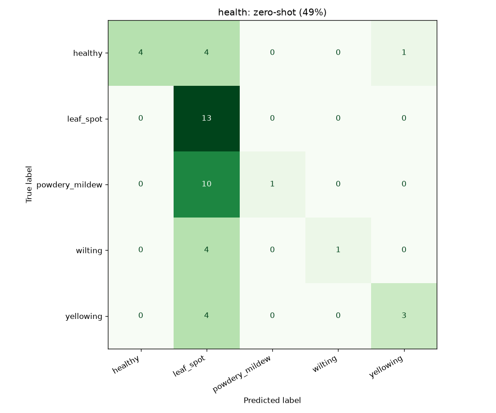
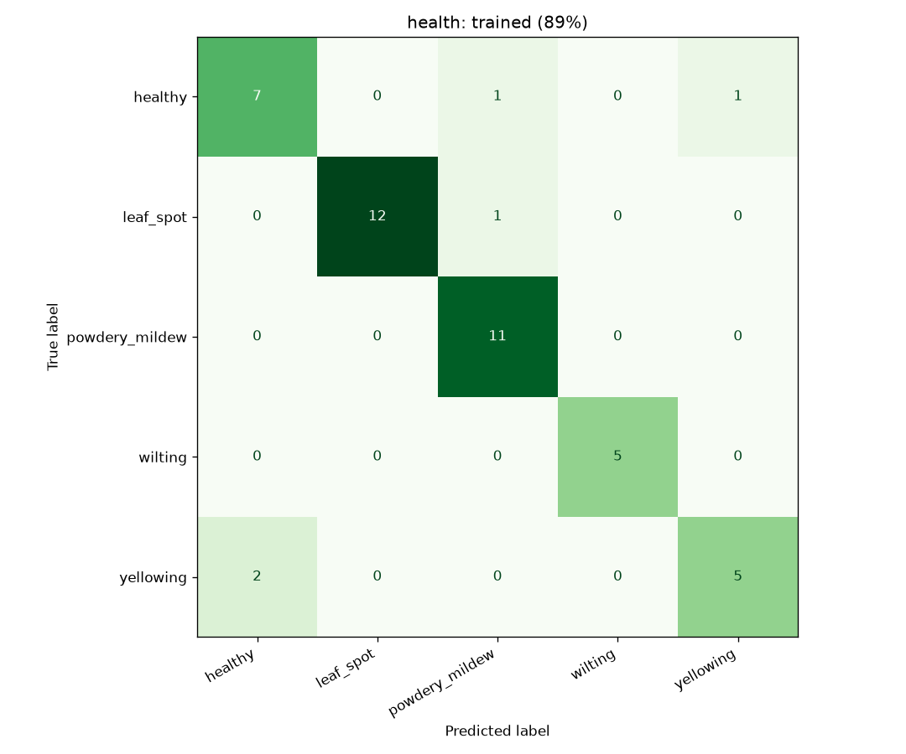

# health report
_Generated 2026-10-22 15:54_

Photos used: 45 (healthy=9, leaf_spot=13, powdery_mildew=11, wilting=5, yellowing=7)

| method | accuracy |
|---|---|
| zero-shot CLIP (no training) | 49% |
| trained linear probe (5-fold cross-validation, grouped by plant (45 plants)) | 89% |
| always guess the most common label | 29% |

 

## Photos the trained model got wrong
- `p57163025_healthy.jpg`: is **healthy**, predicted powdery_mildew
- `p57313115_yellowing.jpg`: is **healthy**, predicted yellowing
- `p57185038_leaf_spot.jpg`: is **leaf_spot**, predicted powdery_mildew
- `p57293101_yellowing.jpg`: is **yellowing**, predicted healthy
- `p57324125_yellowing.jpg`: is **yellowing**, predicted healthy
