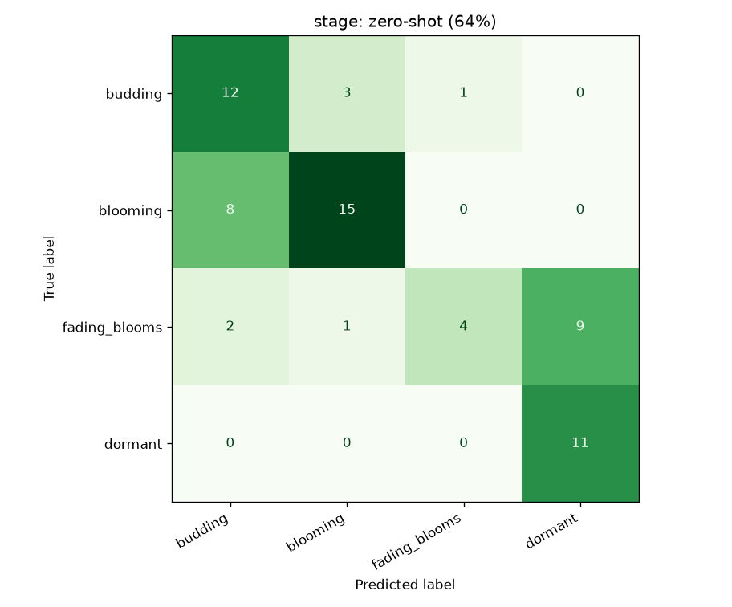
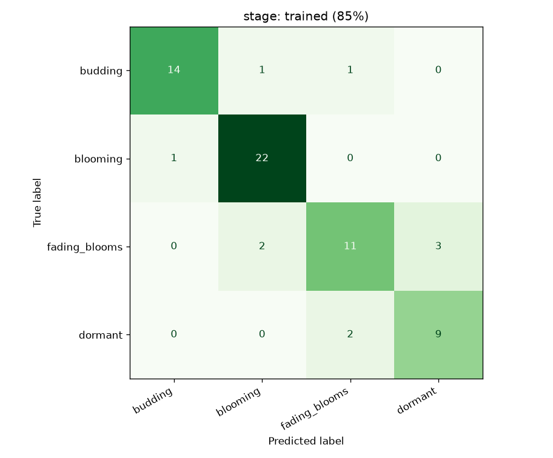

# stage report
_Generated 2026-10-22 15:54_

Photos used: 66 (budding=16, blooming=23, fading_blooms=16, dormant=11)

| method | accuracy |
|---|---|
| zero-shot CLIP (no training) | 64% |
| trained linear probe (5-fold cross-validation, grouped by plant (66 plants)) | 85% |
| always guess the most common label | 35% |

 

## Photos the trained model got wrong
- `p57383158_budding.jpg`: is **budding**, predicted fading_blooms
- `p57390164_budding.jpg`: is **budding**, predicted blooming
- `p57435196_blooming.jpg`: is **blooming**, predicted budding
- `p57262082_wilting.jpg`: is **fading_blooms**, predicted dormant
- `p57266085_wilting.jpg`: is **fading_blooms**, predicted dormant
- `p57267086_wilting.jpg`: is **fading_blooms**, predicted dormant
- `p57454208_fading_blooms.jpg`: is **fading_blooms**, predicted blooming
- `p57468216_fading_blooms.jpg`: is **fading_blooms**, predicted blooming
- `p57342130_dormant.jpg`: is **dormant**, predicted fading_blooms
- `p57370150_dormant.jpg`: is **dormant**, predicted fading_blooms
